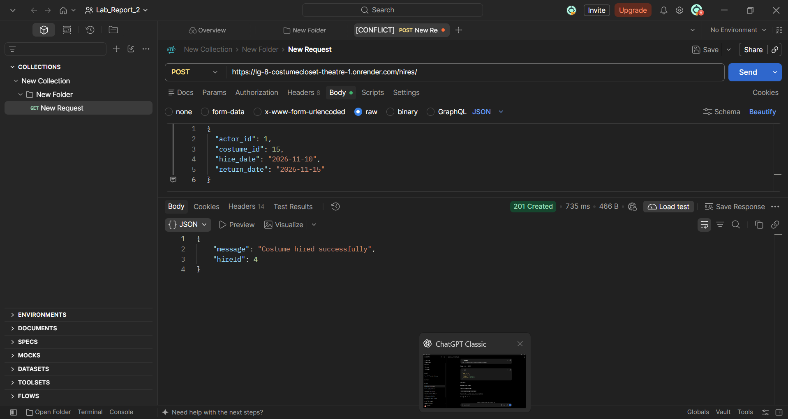
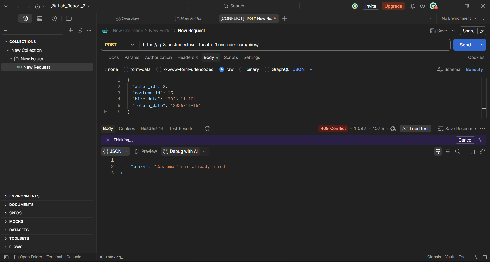
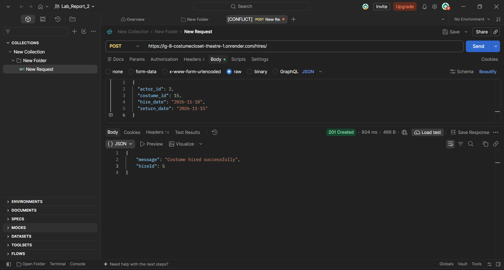
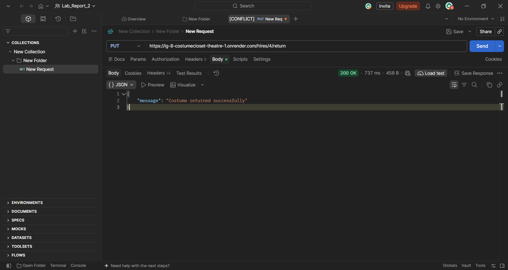

# 🎭 CostumeCloset Theatre

A RESTful backend API for managing theatre actors, costumes, and costume hire records, built using Node.js, Express.js, and SQLite.

## 📌 Project Overview

CostumeCloset Theatre is a backend application designed to help theatre organizations manage their costume inventory and hiring activities.

The system maintains records of actors, available costumes, and costume hire transactions. It prevents a costume from being hired by multiple actors simultaneously.

### Problem Statement

Theatre organizations often face difficulties tracking which actor has borrowed a particular costume and whether it has been returned. This can lead to double bookings, delayed returns, and poor inventory management.

### Solution

CostumeCloset Theatre provides REST API endpoints to:
- Manage actor records.
- Perform CRUD operations on costumes.
- Create and manage costume hire records.
- Retrieve hire information using SQL JOIN operations.
- Search costumes by historical era.
- Prevent double booking of costumes.

## ✨ Key Features

- **Actor Management:** Create, retrieve, update, and delete actor records.
- **Costume Management:** Perform CRUD operations on costumes.
- **Hire Management:** Record costume hiring and returns.
- **Search Functionality:** Filter costumes using the era query parameter.
- **JOIN Operations:** Retrieve hire records with actor names and costume names.
- **Input Validation:** Validate required fields and identifiers.
- **No Double Booking:** Prevents a costume from being hired by two active actors simultaneously.
- **HTTP Status Codes:** Uses appropriate status codes such as 200, 201, 400, 404, and 409.

## 🛠️ Technology Stack

| Technology | Purpose |
|---|---|
| Node.js | JavaScript runtime |
| Express.js | Backend framework |
| SQLite | Relational database |
| sqlite3 | SQLite database driver |
| sqlite | Promise-based SQLite interface |
| Postman | API testing |
| Render | Application deployment |
| GitHub | Version control and hosting |

## 📂 Project Structure

```text
GA-CostumeCloset-Theatre/
│
├── config/
│   └── database.js
│
├── controllers/
│   ├── actorController.js
│   ├── costumeController.js
│   └── hireController.js
│
├── database/
│   └── costume_closet.db
│
├── routes/
│   ├── actorRoutes.js
│   ├── costumeRoutes.js
│   └── hireRoutes.js
│
├── screenshots/
│   ├── costume-return-success.png
│   ├── no-double-booking-test-1.png
│   ├── no-double-booking-test-2.png
│   └── no-double-booking-test-3.png
│
├── postman/
│   └── CostumeCloset-Theatre-API.postman_collection.json
│
├── server.js
├── package.json
├── package-lock.json
└── .gitignore
```

## 🗄️ Database Design

The application uses an SQLite database named `costume_closet.db`.

It contains three related tables:

### 1. Actors

Stores information about theatre actors.

| Column | Description |
|---|---|
| actor_id | Primary key |
| actor_name | Actor's name |
| phone | Contact number |

### 2. Costumes

Stores costume inventory information.

| Column | Description |
|---|---|
| costume_id | Primary key |
| name | Costume name |
| era | Historical era |

### 3. Hires

Stores costume hiring transactions.

| Column | Description |
|---|---|
| hire_id | Primary key |
| actor_id | Foreign key referencing actors |
| costume_id | Foreign key referencing costumes |
| hire_date | Hiring date |
| return_date | Expected return date |
| returned | Return status (0 = Not returned, 1 = Returned) |

### Relationships

- One actor can have multiple hire records.
- One costume can have multiple hire records over time.
- Each hire record references one actor and one costume.

## 🔗 API Endpoints

**Base URL:**

```text
https://lg-8-costumecloset-theatre-1.onrender.com
```

### Actors API

| Method | Endpoint | Description |
|---|---|---|
| GET | `/actors/` | Retrieve all actors |
| GET | `/actors/:actorId` | Retrieve actor by ID |
| POST | `/actors/` | Add a new actor |
| PUT | `/actors/:actorId` | Update actor |
| DELETE | `/actors/:actorId` | Delete actor |

### Costumes API

| Method | Endpoint | Description |
|---|---|---|
| GET | `/costumes/` | Retrieve all costumes |
| GET | `/costumes/:costumeId` | Retrieve costume by ID |
| POST | `/costumes/` | Add a new costume |
| PUT | `/costumes/:costumeId` | Update costume |
| DELETE | `/costumes/:costumeId` | Delete costume |
| GET | `/costumes/?era=Medieval` | Search costumes by era |

### Hires API

| Method | Endpoint | Description |
|---|---|---|
| GET | `/hires/` | Retrieve all hire records |
| GET | `/hires/:hireId` | Retrieve hire by ID |
| POST | `/hires/` | Create a costume hire |
| PUT | `/hires/:hireId/return` | Return a costume |
| GET | `/hires/details` | Retrieve hire details using JOIN |

## 🚫 Special Challenge: No Double Booking

The main challenge of this project is preventing the same costume from being hired by two actors at the same time.

### Implementation

Before creating a new hire record, the backend checks whether the requested costume already has an active hire.

```sql
SELECT hire_id
FROM hires
WHERE costume_id = ?
AND returned = 0;
```

If an active hire exists, the API rejects the request with:

**HTTP Status: 409 Conflict**

Response:

```json
{
  "error": "Costume 15 is already hired"
}
```

Once the costume is returned, its active hire status is cleared, allowing another actor to hire it.

### Mandatory Test Cases

| Test | Scenario | Expected Result |
|---|---|---|
| Test 1 | Asha hires Costume 15 | 201 Created |
| Test 2 | Ravi attempts to hire Costume 15 while Asha has it | 409 Conflict |
| Test 3 | Asha returns Costume 15 | 200 OK |
| Test 4 | Ravi hires Costume 15 after its return | 201 Created |

All mandatory no-double-booking scenarios were tested successfully using Postman.

## 📸 Screenshots

### No Double Booking – Test 1



### No Double Booking – Test 2



### No Double Booking – Test 3



### Costume Return Success



## 🚀 Installation and Setup

### Prerequisites

- Node.js
- npm
- Git

### 1. Clone the repository

```bash
git clone YOUR_GITHUB_REPOSITORY_URL
```

### 2. Navigate to the project directory

```bash
cd GA-CostumeCloset-Theatre
```

### 3. Install dependencies

```bash
npm install
```

### 4. Start the development server

```bash
npm run dev
```

### 5. Access the application

```text
http://localhost:3000/
```

## 🧪 API Testing with Postman

The application was tested using Postman.

The Postman collection contains five folders:

1. Actors API
2. Costumes API
3. Hires API
4. JOIN Operations
5. No Double Booking Challenge

**Postman Collection:** `postman/CostumeCloset-Theatre-API.postman_collection.json`

## 🌐 Deployment

The backend application is deployed on Render.

**Live API:**

https://lg-8-costumecloset-theatre-1.onrender.com/

**Welcome Endpoint:**

https://lg-8-costumecloset-theatre-1.onrender.com/

## 🎓 Academic Information

| Field | Details |
|---|---|
| Project | CostumeCloset Theatre |
| Subject | Backend Development Fundamentals |
| Institution | Aurora |
| Group Code | ST-CSEQE2A-G08 |
| Theme | Theme 8 – Costume Hire |
| Modules | I, II and III |

## 👨‍💻 Author

**LEARNING GROUP - 8**

B.Tech – Computer Science and Engineering

Section: 106 AIDE-2A

## 📄 License

This project was developed as part of an academic group assignment for Backend Development Fundamentals.